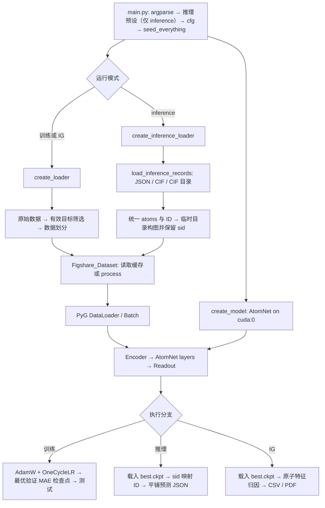

# AtomNet Code Review：研究者代码阅读与实验指南

> 更新日期：2026-10-30；代码基线：`715087b`（结合最新版中文 README 同步）。本文基于当前仓库源码、描述符数据和 README 的静态审阅，帮助研究者理解实现、开展实验并识别复现边界。实验配置来自仓库说明，未独立核验论文全文或运行完整训练。本次未执行 GPU 训练或检查点推理；下文命令已按源码参数核对，不代表已通过端到端运行验证。

快速导航：[目录与阅读顺序](#2-目录地图与阅读顺序) · [数据与张量](#4-数据流与张量约定) · [模型实现](#5-模型实现与论文模块的对应) · [第一个实验](#6-开始第一个实验) · [任务配置](#7-论文任务配置速查) · [推理与 IG](#8-查看结果推理与解释性分析) · [复现问题](#10-会影响复现的代码审阅发现)

## 1. 项目解决什么问题

AtomNet 将周期晶体结构转换为图，通过原子描述符、原子间几何信息以及可选的电负性差构造表示，再用消息传递网络预测晶体性质。当前入口执行的是**单目标回归**：每个晶体输出一个标量，每次运行选择一个 `figshare_target`。

理解实现时，可将它分为四部分：

1. **数据准备**：读取 JARVIS/MEGNet 数据，筛选目标有效的结构，划分训练、验证和测试集。
2. **周期图与物理特征**：计算周期邻居、距离和方向；选择原子序数或 116 维原子描述符；可加入 Sanderson 电负性差。
3. **表示学习**：编码节点和边，多层消息传递更新表示，最后对节点预测取均值。
4. **实验与分析**：训练、验证集选模、测试集评估、检查点推理，以及原子描述符的 Integrated Gradients（IG）归因。

源码中的物理信息主要进入输入特征与距离权重函数。`train/metrics.py` 使用 MAE/MSE，当前训练入口没有额外的物理方程约束损失。

## 2. 目录地图与阅读顺序

仓库根目录与 Python 运行目录不同。通常先在仓库根目录配置环境，再进入内部的 `AtomNet/` 执行 `main.py`。

```text
AtomNet/                              # 仓库根目录
├── README.md / README-cn.md           # 论文入口、数据资源和任务配置
├── CODE_REVIEW.md                     # 本阅读指南
├── environment.yml / environment.txt # 作者环境记录
├── figure/                           # 架构图等静态资源
└── AtomNet/                          # Python 代码与实验运行目录
    ├── main.py                       # 参数、全局配置、训练/推理/IG 分支
    ├── atomic_descriptor.py          # 独立的原子描述符生成流程
    ├── ig_framework.py               # IG 归因与可视化
    ├── loader/loader.py              # 数据来源、划分与 DataLoader
    ├── dataset/
    │   ├── figshare_dataset.py        # 原始晶体 → PyG Data → .pt 缓存
    │   ├── utils.py                  # 周期边界邻居搜索及邻居筛选
    │   ├── inference_input.py        # JSON/CIF 输入归一化、ID 与坐标处理
    │   ├── json/                     # 原子描述符与 Sanderson 电负性表
    │   ├── csv/                      # 描述符列名和其他 CSV 文件
    │   ├── jarvis/original/           # 仓库随附的原始数据压缩文件
    │   └── inference/                # inference_data.json 与 cifs/ 示例
    ├── models/
    │   ├── master.py                 # 模型创建与 GPU 放置
    │   ├── atomnet.py                # Encoder、AtomNet_layer、Readout
    │   └── utils.py                  # 距离 RBF、电负性 RBF、距离权重
    ├── train/
    │   ├── train.py                  # 优化、验证、选模、测试及 SWA
    │   └── metrics.py                # MAE/MSE 与日志更新
    ├── logger/logger.py              # 每轮指标聚合与本地记录
    └── scripts/linux_train_atomnet.py # 命令集合与批量执行示例
```

以下位置在下载或运行后才需要出现，不应误认为当前检出已包含这些产物：

```text
AtomNet/dataset/jarvis/processed/      # PyG 自动生成/读取的图缓存
AtomNet/dataset/megnet/               # 手工放置体模量、剪切模量原始 pkl
AtomNet/results/<实验名>/             # 检查点与 train/val/test 日志
AtomNet/wandb/                        # W&B 本地记录（取决于运行配置）
AtomNet/dataset/ig/                   # IG CSV 与 img/ 下的 PDF
```

建议按以下顺序阅读；第一次阅读不必先逐行研究周期邻居搜索的张量索引。

| 顺序 | 源码入口 | 阅读目标 |
| --- | --- | --- |
| 1 | [main.py](AtomNet/main.py) 的主入口 | 确定参数如何进入 `cfg`，运行哪个分支，结果保存在哪里 |
| 2 | [loader.py](AtomNet/loader/loader.py) 的 `create_loader()` | 理解目标筛选、划分种子、数据集缓存命名 |
| 3 | [figshare_dataset.py](AtomNet/dataset/figshare_dataset.py) 的 `process()` | 看一个晶体如何变成节点、边和标签 |
| 4 | [atomnet.py](AtomNet/models/atomnet.py) 的 `Encoder → AtomNet_layer → Readout` | 理解特征维度、消息方向、节点/边更新和输出 |
| 5 | [train.py](AtomNet/train/train.py) 的 `train()` | 理解优化器、学习率、验证集选模与最终测试 |
| 6 | [utils.py](AtomNet/models/utils.py) 和 [周期图工具](AtomNet/dataset/utils.py) | 深入研究 RBF、距离权重和周期邻居机制 |
| 7 | [ig_framework.py](AtomNet/ig_framework.py)、[atomic_descriptor.py](AtomNet/atomic_descriptor.py) | 开展归因或自定义原子特征实验 |

## 3. 从入口到结果的调用关系



项目使用 PyG GraphGym 的全局 `cfg`，但实际实验配置由 `main.py` 的命令行参数补充；没有单独的任务配置 YAML。多个模块直接读取 `cfg`，因此单独导入并实例化模型时，也需要初始化这些配置字段。

`AtomNet.forward()` 返回 `(pred, true)`，模型会直接修改传入 Batch 的 `x` 和 `edge_attr`。调试时若需要对同一个原始 Batch 重复前向，应使用 `batch.clone()`；IG 的包装器已经做了这一处理。

## 4. 数据流与张量约定

### 4.1 数据来源与划分

[create_loader()](AtomNet/loader/loader.py) 的行为如下：

| 命令参数 | 实际来源 | 划分方式 |
| --- | --- | --- |
| `--dataset jarvis` | 将名称转换为 `dft_3d_2021`，调用 `jarvis.db.figshare.data` | 对有效目标样本随机划分，约 80%/10%/10% |
| `--dataset megnet`，普通目标 | 调用 `jarvis.db.figshare.data("megnet")` | 同上 |
| `--dataset megnet`，`bulk modulus` / `shear modulus` | `dataset/megnet/` 中预划分的六个 pkl 文件 | 保留文件原有 train/val/test 划分 |

标量目标会排除 `None`、`"na"` 和 NaN。列表目标也有读取分支，但当前 Readout 固定输出一个标量，不能据此认为已支持多目标训练。标签直接作为 `y` 使用；这条路径未做目标标准化、对数变换或单位转换。报告单位应以所用原始数据字段为准，尤其应核对模量 pkl 中目标的定义。

**数据划分默认固定为 123。** `create_loader(seed=123)` 被主入口无参数调用，`--seed` 传给的是模型/训练随机性设置。改变 `--seed` 并不会改变普通任务的训练/验证/测试划分。`dataset/csv/train_files.csv` 等文件没有被当前 loader 读取，不是当前实验的划分依据。

### 4.2 单个晶体如何构图

`Figshare_Dataset.process()` 先通过 `Atoms.from_dict(ddat["atoms"])` 读取晶格和原子坐标，随后调用 `radius_graph_pbc()` 构造周期图。默认截止半径为 5.0；`max_neighbours=-1` 会转换为不限制邻居数。

周期图包含相邻晶胞镜像带来的边。`edge_index[0]` 是邻居/发送节点，`edge_index[1]` 是中心/接收节点；同一个节点对可能对应不同周期镜像。代码排除近零距离边，但同一原子与其非零距离周期镜像的连接可以保留。距离范围内完全没有边的晶体会被跳过，所以最终图数量可能少于目标筛选后的样本数量。

| 字段 | 单图形状 | 含义 |
| --- | --- | --- |
| `x` | `[N]` 或 `[N, 116]` | 原子序数，或 JSON 中的原子描述符 |
| `y` | 单个标量，批处理后为 `[B]` | 本次任务的目标值 |
| `pos` | `[N, 3]` | 笛卡尔坐标 |
| `cell` | `[1, 3, 3]` | 晶格矩阵 |
| `natoms` | `[1]` | 原子数 |
| `edge_index` | `[2, E]` | 周期邻居 → 中心原子 |
| `cart_dist` | `[E]` | 含周期偏移的原子间距离 |
| `cart_dir` | `[E, 3]` | 周期距离向量的单位方向 |
| `eneg`（可选） | `[E, 1]` | 两端原子的 Sanderson 电负性绝对差 |
| `sid`（自定义推理） | `[1]` | 原始输入记录下标，无边结构跳过后仍用于关联 ID |
| `batch`（批处理生成） | `[ΣN]` | 每个节点所属的晶体索引 |

这里 `N` 为原子数，`E` 为边数，`B` 为批次内晶体数。开启 `normalizedElectronegativity` 时，`eneg` 在**每个晶体内部**通过 `StandardScaler.fit_transform()` 标准化，并非使用整个训练集的统计量。

### 4.3 图缓存如何复用

训练/验证/测试图缓存由 `InMemoryDataset` 写入 `<dataset_path>/processed/`。文件名包括数据集、半径、邻居上限、目标、划分种子、split、描述符名称和电负性开关。例如：

```text
dft_3d_2021_5.0_-1_formation_energy_peratom_123_train_atom_features(116d)_update01.json_electronegativity.pt
```

RBF、多项式和模型宽度属于模型内计算，不需要逐项进入图缓存名。但**描述符 JSON 内容变化、原始数据版本变化或构图算法变化**没有自动内容校验；复用同名缓存会沿用旧图。修改这些内容时，应使用新的描述符名/数据目录，并记录对应版本。

README 写的是 `preprocessed/`，当前代码实际读取的是 `processed/`。外部预处理文件应按源码要求放置、匹配文件名和序列化结构。即使缓存存在，`create_loader()` 仍先调用原始数据接口或读取 pkl，不能把现有缓存等同于完全脱离原始数据的离线加载入口。

## 5. 模型实现与论文模块的对应

### 5.1 原子描述符与节点编码

默认 `--atom_init atom_number` 使用 `Embedding(119, 512)`；论文任务示例通常使用 `atom_features(116d)_update01`，通过 `Linear(116, 512)` 输入。两者随后均经 SiLU 和线性层映射到 `dim_in=256`。

仓库提供的描述符 JSON 有 118 个元素条目，原子序数键为 `1…118`，每个向量长度为 116。对应 CSV 的 118 行与 JSON 数值逐行一致；CSV 首列是从 0 开始的行索引，映射原子序数时需加 1。

| 特征组 | 仓库提供的维度 |
| --- | --- |
| 周期 `period` | 7 |
| 族 `group_id` | 18 |
| 电子区块 `block` | 4 |
| 价电子数 `nvalence` | 17 |
| `atomic_volume`、`c6`、`electronegativity_sanderson`、`electron_affinity`、`lattice_constant`、`atomic_radius`、`Ionization energy` | 各 10，共 70 |
| 总计 | 116 |

这些维度主要是分类或连续属性分箱后的 one-hot 表示，不是 116 个独立的原始物理量。`atomic_descriptor.py` 独立运行，负责取物性、分箱和编码；常规训练直接读取已有 JSON，不会调用该脚本。

Sanderson 电负性文件另行提供，长度为 117，按原子序数减 1 索引。它与描述符的元素覆盖范围不同；包含原子序数 118 的结构不能直接使用当前电负性表。

### 5.2 边编码

默认边输入拼接如下，再由 MLP 映射到 256 维：

```text
距离 RBF（64） + 距离多项式 d,d²,d³（3） + 单位方向（3）
              + 可选电负性特征
```

| 电负性配置 | 附加维度 | 默认几何配置下的边输入总维度 |
| --- | --- | --- |
| 不使用 | 0 | 70 |
| 原始差值或归一化差值，`eneg_type=None` | 1 | 71 |
| `newRBF` | 20 | 90 |
| `newRBF02/03/04/05` | 64 | 134 |

`ExpNormalSmearing` 的距离 RBF 内部自带余弦截止因子。消息传递还可以额外使用 `simply` 或 `cubic` 距离权重。因此 `--disable_envelope` 只关闭消息层的距离权重，不会移除 RBF 内部的截止因子。

默认输入包含 `cart_dir`，源码没有保证这一路径对旋转不变。`--invariant` 分支仅输入距离 RBF，省略方向、多项式和电负性；但当前它与电负性同时使用存在维度冲突，见第 10 节。

### 5.3 消息传递

每层先由中心节点、邻居节点与边表示计算通道权重，再聚合邻居消息。用实现对应的符号可写为：

```text
g_ij = activation(norm(MLP_gate([h_i, h_j, e_ij])))
σ_ij = envelope(d_ij) · g_ij                 # 启用距离权重时
m_i  = Σ_j σ_ij ⊙ MLP_aggr([h_i, h_j, e_ij])
h_i' = h_i + SiLU(BatchNorm(m_i))
e_ij'= e_ij + σ_ij                          # 该层允许更新边时
```

其中 `⊙` 表示逐通道乘法。`mbj_bandgap` 任务的门控使用 BatchNorm + Sigmoid，其他任务使用 LayerNorm + GELU；后者不是限定在 `[0,1]` 的概率。这里没有对邻居做 softmax。节点聚合后的归一化 `norm2` 在两种任务设置下都使用 BatchNorm。

`--onlyAtomFeaUpdate` 仅让 `MLP_aggr` 使用 `[h_i,h_j]`；门控仍使用边特征，边是否更新仍由 `disableUpdateEdge/limitedUpdateEdge` 决定。

### 5.4 输出与优化

Readout 先将每个节点的 256 维表示映射为一个标量，再按晶体做**均值池化**，得到 `[B]` 预测。扩展到其他目标时，应考虑该均值读出是否符合目标的尺度定义。

训练使用 AdamW，默认学习率 `1e-3`、`betas=(0.9,0.98)`、`weight_decay=0.01`；OneCycleLR 随优化器更新推进。每轮执行训练和验证，以**验证 MAE 最小**的轮次保存 `best.ckpt`。训练结束重新加载该检查点，再评估测试集。即使训练损失改成 MSE，选模指标仍是 MAE。

日志按样本数加权聚合 MAE/MSE，并计算全体预测的 R² 和 Spearman 相关系数。可选 SWA 使用独立的 `swa.ckpt` 路径与格式，不能直接代替标准推理分支所需的 `best.ckpt`。

## 6. 开始第一个实验

### 6.1 环境准备

在仓库根目录，可按项目提供的流程建立环境：

```shell
conda env create -f environment.yml
conda activate atomnet
```

`environment.yml` 包含 Linux 专用包与具体构建号，是作者环境快照。Windows 上若无法直接解析，应参照 [README-cn.md](README-cn.md) 的手工配置流程，并记录自己的环境。文件记录的核心版本包括 Python 3.11.11、PyTorch 2.1.2 / CUDA 12.1、PyG 2.6.1、NumPy 1.26.4、JARVIS-tools 2024.10.30、Captum 0.8.0。README 手工记录中的 `mendeleev==0.14.0` 与环境快照的 `1.1.0` 不同；描述符生成实验尤其需要保留所用版本。

进入代码目录后检查依赖和 CUDA：

```shell
cd AtomNet
python -c "import torch, torch_geometric, torch_scatter, jarvis, captum, roma, wandb; print('torch:', torch.__version__); print('CUDA:', torch.version.cuda, torch.cuda.is_available()); print('PyG:', torch_geometric.__version__)"
```

当前程序将模型和批次放到 `cuda:0`，没有 CPU 运行参数。CUDA 断言位于参数解析之前，所以 `python main.py --help` 也要求 CUDA 可用。需要指定物理 GPU 时，在启动 Python 前设置 `CUDA_VISIBLE_DEVICES`。

### 6.2 首次运行使用本地 W&B 记录

训练会直接调用 `wandb.init()`。在线记录需设置自己的 `--wandb_project`、`--wandb_entity` 和登录信息。首次检查流程可先设置离线模式：

PowerShell：

```powershell
$env:WANDB_MODE = "offline"
```

Bash：

```bash
export WANDB_MODE=offline
```

W&B 离线模式只影响训练记录，数据接口仍可能需要联网。

### 6.3 用少量轮次检查流程

在内部 `AtomNet/` 目录运行以下单行命令。描述符名称用引号包围，适用于 PowerShell 和 Bash：

```shell
python main.py --dataset jarvis --figshare_target formation_energy_peratom --seed 206 --name smoke_formation --atom_init "atom_features(116d)_update01" --useElectronegativity --electronegativity_type newRBF --envelope_type simply --disableUpdateEdge --limitedUpdateEdge 2 --batch 32 --workers 1 --threads 4 --epochs 3 --warmup 0.1 --wandb_project atomnet_smoke --wandb_entity local
```

该命令减少训练轮数和 batch，不减少数据集大小；首次仍会加载并预处理完整任务数据。`workers` 先设为 1，是因为训练/验证 loader 固定启用 `persistent_workers=True`，直接使用 `--workers 0` 会冲突。

检查流程通过的可观察结果：

- 启动日志打印正确的目标、实验名、模型参数量及保存目录。
- 完成 train/val 的多轮记录，loss 与 MAE 为有限值。
- `results/<实验名>/ckpt/best.ckpt` 已生成。
- 训练结束载入 best checkpoint，并输出测试集指标。

这次短训练只用于检查链路；正式实验应使用任务对应配置和独立实验名。

### 6.4 正式形成能实验示例

```shell
python main.py --seed 206 --name dft_3D_formation_energy --dataset jarvis --figshare_target formation_energy_peratom --threads 10 --workers 5 --epochs 300 --atom_init "atom_features(116d)_update01" --useElectronegativity --batch 128 --disableUpdateEdge --limitedUpdateEdge 2 --envelope_type simply --electronegativity_type newRBF --wandb_project atomnet_reproduction --wandb_entity local
```

此处 W&B 参数用于前述离线设置；在线运行时换成自己的项目与账户。硬件资源不足时可降低 batch，但应将其记为实验配置变化。

## 7. 论文任务配置速查

以下表格转录自当前 README 的训练示例。共同设置为 `epochs=300`、`atom_init=atom_features(116d)_update01`、默认 `usePolynomial=3`、`radius=5.0`、`num_layers=4`、`dim_in=256`、`dim_rbf=64`、`max_neighbours=-1`。它列的是示例种子，不是十次重复实验的完整种子清单。

| 数据集 | `figshare_target` | 示例 seed | batch | envelope | 电负性配置 | 边更新配置 |
| --- | --- | --- | --- | --- | --- | --- |
| jarvis | `formation_energy_peratom` | 206 | 128 | simply | `useElectronegativity` + newRBF | 禁用后续更新，`limitedUpdateEdge=2` |
| jarvis | `optb88vdw_bandgap` | 448 | 128 | cubic | 不使用 | 同上 |
| jarvis | `mbj_bandgap` | 296 | 64（默认） | simply | 不使用 | 不传 `disableUpdateEdge`，全部层更新 |
| jarvis | `ehull` | 510 | 128 | cubic | `useElectronegativity` + newRBF04 | `limitedUpdateEdge=2` |
| jarvis | `optb88vdw_total_energy` | 306 | 128 | cubic | `useElectronegativity` + newRBF | `limitedUpdateEdge=2` |
| megnet | `e_form` | 235 | 128 | simply | `useElectronegativity`，原始差值 | `limitedUpdateEdge=2` |
| megnet | `gap pbe` | 331 | 128 | cubic | 不使用 | `limitedUpdateEdge=2` |
| megnet | `bulk modulus` | 536 | 64 | simply | `useElectronegativity` + `normalizedElectronegativity` | `limitedUpdateEdge=2` |
| megnet | `shear modulus` | 440 | 64 | cubic | `useElectronegativity` + newRBF02 | `limitedUpdateEdge=2` |

表中有限更新均需同时传 `--disableUpdateEdge --limitedUpdateEdge 2`。含空格的目标应写成 `--figshare_target "bulk modulus"` 等形式。

模量任务需要在 `dataset/megnet/` 放置以下文件，资源入口见 README：

```text
bulk_megnet_train.pkl   bulk_megnet_val.pkl   bulk_megnet_test.pkl
shear_megnet_train.pkl  shear_megnet_val.pkl  shear_megnet_test.pkl
```

`scripts/linux_train_atomnet.py` 是候选命令集合，末尾目前只执行 `jarvis` 列表；`megnet/ig/inference` 列表不会自动执行。脚本使用 `os.chdir("..")`，按当前实现应从 `AtomNet/scripts/` 启动；直接调用 `main.py` 更易明确工作目录。最新版中文 README 只列出了现有的 Linux 脚本入口。

## 8. 查看结果、推理与解释性分析

### 8.1 训练产物

运行结果写到内部代码目录下的 `results/<cfg.name>/`，不是简单的 `results/<--name>/`。`main.py` 会把种子、batch、envelope、电负性配置、邻居设置和描述符名拼接到用户提供的名称前面，具体路径以启动日志为准。

| 产物 | 用途 |
| --- | --- |
| `ckpt/best.ckpt` | 验证 MAE 最优模型；字典包含 `model_state` 和 `optimizer_state` |
| `train/stats.json`、`val/stats.json`、`test/stats.json` | 对应 split 的逐轮/最终指标，由 GraphGym 日志路径组织 |
| `ckpt/swa.ckpt`（启用 SWA 时） | AveragedModel 的独立 state dict |
| `wandb/` 下的运行记录 | 在线或离线训练记录 |

`best.ckpt` 没有完整配置、scheduler 状态和 epoch 字段，主入口也没有训练恢复参数。保存检查点时还应保存完整命令和环境记录。

### 8.2 任务预设、检查点选择与旧命令兼容

10 月 30 日更新后，`--inference` 默认读取自定义输入，`cfg.useProcessedData=False`。无需修改源码即可输入 JSON、单个 CIF 或 CIF 目录；无标签推理也已通过 `useProcessedData and size>0` 条件避免计算无效 MAE。

`main.py` 的 `inference_presets` 覆盖第 7 节的九个数据集/目标组合。短命令仅需指定数据集、目标和输入：

```shell
python main.py --dataset jarvis --figshare_target formation_energy_peratom --inference --inference_data_path dataset/inference/cifs --inference_results_path dataset/inference/formation_predictions.json
```

每个预设覆盖 seed、batch、name、atom_init、envelope_type 及电负性设置，并指定固定的 `results/<preset.run_name>/ckpt/best.ckpt`。下载模型应放入实际代码运行目录下的 `results/`；支持某任务的预设不代表仓库已附带该任务的权重。

旧的完整推理命令仍可解析，但其中上述字段会被预设覆盖；未指定输入时读取默认的 `dataset/inference/inference_data.json`。预设未恢复所有训练参数，例如 `disableUpdateEdge/limitedUpdateEdge`；需要精确复现时，应保留检查点对应的完整模型配置。不能仅以“成功加载权重”判断前向行为一致。

**自己的检查点需要特别处理**：已匹配预设的任务即使传入自定义 `--name`，检查点选择仍使用预设路径。当前没有 `--checkpoint` 开关，应调整 `inference_presets` 或检查点选择逻辑，再使用完整训练配置。未匹配预设时才回退到 `cfg.run_dir/ckpt/best.ckpt`。

训练结束的测试评估流程不变。`create_inference_loader(use_processed_data=True)` 仍保留测试集分支，但 CLI 没有暴露该切换参数；不要把现在的 `--inference` 输出理解为带标签测试集误差。

### 8.3 JSON/CIF 输入、ID 对齐与输出

新模块 [inference_input.py](AtomNet/dataset/inference_input.py) 的 `load_inference_records()` 统一输出 `[{"id": ..., "atoms": {...}}, ...]`，随后由 `Figshare_Dataset` 构图。

| 输入 | 归一化规则与 ID 来源 |
| --- | --- |
| JSON 字典 | 推荐 `{"sample_id": {"atoms": {...}}, ...}`，字典键作为 ID |
| JSON 旧列表 | 兼容 `[{"atoms": {...}}, ...]`；依次取 `id/reference/jid/mp_id`，缺省为 `文件名去后缀#零基序号` |
| 单条 JSON 结构 | 支持含 `atoms` 的单条记录或直接的 atoms 字典 |
| 单个 `.cif` / `.mcif` | 文件名去后缀作为 ID |
| 目录 | 仅扫描当前层，按文件名排序处理 CIF；有 CIF 时忽略 JSON，没有 CIF 且只有一个 JSON 时读取该文件，多 JSON 时需显式指定 |

推荐 JSON 格式示意（数值不代表已验证预测）：

```json
{
  "sample_NaCl": {
    "atoms": {
      "lattice_mat": [[5.0, 0.0, 0.0], [0.0, 5.0, 0.0], [0.0, 0.0, 5.0]],
      "coords": [[0.0, 0.0, 0.0], [2.5, 2.5, 2.5]],
      "elements": ["Na", "Cl"],
      "cartesian": true,
      "props": []
    }
  }
}
```

必需字段为 `lattice_mat/coords/elements`；坐标必须与 `cartesian` 一致，未提供该标志时按分数坐标处理，`props` 会补全。无需提供标签。仓库 [inference_data.json](AtomNet/dataset/inference/inference_data.json) 当前使用 ID 字典格式，另有 `dataset/inference/cifs/` 示例可直接作为目录输入。

```shell
python main.py --dataset jarvis --figshare_target formation_energy_peratom --inference --inference_data_path dataset/inference/cifs/mp-19306_Fe3O4.cif --cif_primitive
```

CIF 优先由 pymatgen `Structure.from_file()` 解析并展开对称操作；未安装或解析失败时回退 JARVIS。pymatgen 路径使用分数坐标、行向量晶格矩阵，补充 `abc/angles/props`。多组分占位取占有率最高的元素并记录日志；这是对无序结构的简化。`--cif_primitive` 仅在 pymatgen 路径执行 `get_primitive_structure()`，JARVIS 回退路径不执行原胞转换。Fe3O4 常规胞到原胞可由 56 原子降到 14 原子，具体取决于输入结构。

推理图使用 `TemporaryDirectory` 构建并载入内存后删除临时文件，不再使用按分钟命名的持久缓存；当前自定义推理分支也不使用 `--inference_path` 作为缓存根目录。`create_inference_loader()` 返回 `(loader, ids)`。每个成功构图的样本保留原始下标 `sid`；跳过无边结构后，`inference()` 仍可通过 `ids[sid]` 对齐 ID，并记录跳过数量。

输出默认写入 `dataset/inference/inference_results.json`，可由 `--inference_results_path` 指定另一个 JSON 文件；输出目录自动创建。结果为平铺列表，预测保留六位小数：

```json
[
  {"id": "mp-19306", "prediction": -0.123456},
  {"id": "mp-19306_frac", "prediction": -0.234567}
]
```

结果 ID 对应输入字典键或 CIF 文件名，无需再自行维护 batch 顺序映射。无边样本不产生结果，因此输出数量可能少于输入。`--inference_data_path` 是输入路径，`--inference_results_path` 是输出文件路径，两者不可互换。

### 8.4 原子描述符 IG 分析

使用训练时的 116 维描述符配置和检查点，追加 `--ig`。主入口将 `loaders[0]` 传入 `IG_metric()`，所以当前分析对象是**训练集**。

流程为：零基线 → 原子特征 IG → 同晶体内对节点归因取均值 → 取绝对值 → 跨晶体取均值 → 按特征名去掉最后一个下划线后缀进行分组求和。先节点均值再取绝对值会允许正负归因在晶体内部抵消，应在研究报告中明确这一聚合口径。

脚本分别使用 `n_steps=[20,32,64,128]`，比较 Spearman、Kendall 和 Top-8 重合率。产物位于 `dataset/ig/` 的逐维/分组 CSV 和 `dataset/ig/img/` 的 PDF。`IG_metric()` 当前断言 CSV 列数为 116，不能直接用于原子序数输入或任意维度的新描述符。

该分析只对节点输入特征归因，没有直接对距离、方向或边电负性求 IG，也不等同于物性之间的因果结论。建议先用少量样本检查输出维度和数值，再运行完整训练集归因；完整分析需多次积分前向与反向。

## 9. 消融与扩展实验从哪里修改

| 研究目标 | 配置或修改位置 | 实验记录要点 |
| --- | --- | --- |
| 比较原子序数与物性描述符 | `--atom_init` | 输入维度、描述符版本和缓存目录 |
| 去除距离多项式 | `--usePolynomial 0` | 保持其余特征和划分不变 |
| 比较电负性及 RBF | 电负性开关、`--electronegativity_type` | 归一化开启时 RBF 类型被置为 None |
| 比较距离权重 | `--envelope_type cubic/simply` 或 `--newEnvelope` | `--newEnvelope` 实际关闭新权重并改用余弦 |
| 控制边更新 | `--disableUpdateEdge --limitedUpdateEdge K` | 实际更新零基层索引 `<K`，不是 `K+1` 层 |
| 改变网络规模 | `--num_layers`、`--dim_in`、`--dim_rbf` | 参数量、显存和训练时间 |
| 改变邻域 | `--radius`、`--max_neighbours` | 半径影响构图，但距离 RBF 当前仍用模型默认 5.0；先处理第 10 节问题 |
| 新增回归目标 | loader 的数据字段、`--figshare_target` | 标签定义、单位、缺失值及 readout 是否合适 |
| 新增数据来源 | `create_loader()` 与 `Figshare_Dataset.process()` | 保持 `atoms` 结构和 PyG 字段契约 |
| 生成新原子描述符 | `atomic_descriptor.py`、`Encoder`、CLI choices、IG 维度检查 | 同时保存 JSON/CSV，维护列名顺序与原子序数映射 |

新增描述符时，生成脚本把 CSV/JSON 写到**当前工作目录**，需要分别放入 `dataset/csv/` 和 `dataset/json/`。模型从文件名的 `(<维度>d)` 提取输入维度，但 CLI 当前只允许 `atom_number` 和 `atom_features(116d)_update01`；单放入新文件还不能通过参数检查。虽然模型中有 `cgcnn` 分支、仓库有对应 JSON，当前 CLI 也未开放该选项。

## 10. 会影响复现的代码审阅发现

以下内容按当前源码行为记录。旧版的默认测试集推理、无标签 MAE 除零、分钟级推理缓存与缺少输出 ID 问题已由新接口处理，不再列为待修复项。表中的“建议”供后续修订或实验规避使用。

| 优先级 | 位置与触发条件 | 当前行为及影响 | 建议 |
| --- | --- | --- | --- |
| 高 | `main.py` 的 `inference_presets` 与检查点选择 | 对已支持任务覆盖自定义 seed/name 等字段并固定检查点路径；预设不包含全部前向参数，短命令与旧完整配置可能有差异 | 自定义检查点调整选择逻辑；核对边更新等完整训练配置 |
| 高 | `models/master.py:8`、`models/utils.py:75`；改变 `--radius` | 构图使用 `cfg.radius`，创建 AtomNet 未传 radius，编码器距离 RBF 仍为 5.0；新权重又写死 1/5 的区间或 0.2 系数 | 将同一半径传给编码器并统一权重参数；处理后再解释半径消融 |
| 高 | `models/atomnet.py:88–124`；`--invariant --useElectronegativity` | 构造阶段仍为电负性增加输入维度，前向 invariant 分支只提供距离 RBF，导致线性层维度不匹配 | 为 invariant 分支统一维度与拼接规则；当前避免该组合 |
| 高 | `dataset/figshare_dataset.py` 的电负性索引；`--atom_init atom_number --useElectronegativity` | 原子序数路径是 `[N]` Tensor，电负性代码却按描述符路径的二维列表取 `[0]`，存在标量索引失败 | 统一原子序数数组与整数索引；当前电负性实验使用已有 116 维描述符 |
| 中 | `models/atomnet.py:232`；有限边更新 | 条件为 `idx < limitedUpdateEdge`，所以 K=2 只更新第 0、1 层；与 README 的“前 K+1 层”不一致 | 复现当前检查点时保留源码行为；修订说明或明确版本化实现变更 |
| 中 | `models/atomnet.py:95`；`normalized_Polynomial` 与电负性 RBF 同时开启 | 构造阶段电负性按 1 维计数，前向仍拼接 20/64 维 RBF，维度冲突 | 维度判断应基于实际电负性分支；当前避免该组合 |
| 中 | `main.py` 的实验名生成 | 名称遗漏半径、学习率、多项式阶数、层数等；不同配置可能写入同一路径 | 给每组实验独立 `--name`，并保存完整配置 |
| 中 | `atomic_descriptor.py:12`、`:33`、`:280`；重新生成描述符 | 文件存在性检查拼接错误，冲突分支调用 `os.path.exists` 参数数目错误；元素区间切片与合并需核对；入口为 20 bins，而现有 CSV 连续组各为 10 维 | 修正命名和元素映射，固定分箱随机性，核对生成结果；直接复现先使用仓库提供的文件 |
| 中 | `train/train.py:54`、`:196`；`batch_accumulation>1` | backward 前未按累积次数缩放 loss；scheduler 的 total_steps 与每轮实际更新次数可能不一致 | 默认使用 1；扩展时明确梯度缩放，并按每轮更新次数计算步数 |
| 中 | `loader/loader.py` 的 DataLoader；`workers=0` | train/val 固定 `persistent_workers=True`，与零 worker 不兼容 | 使用至少 1 个 worker，或按 worker 数条件开启持久进程 |
| 中 | `logger/logger.py:14–17` | 全局替换 `warnings.warn`，会隐藏依赖、数值和归因相关警告 | 调试时恢复警告，仅过滤已确认的特定提示 |

其他研究边界：`normalized_Polynomial` 使用当前 batch 内边距离的最小/最大值，同一结构的特征可能随批次组成变化；正邻居上限默认采用保留近简并邻居的规则，并非严格 K 条边，而且该处容差作用于传入的**距离平方**。`max_neighbours` 主要改变边数、显存和计算量，不直接改变固定网络的可训练参数量。

SWA 分支还需单独检查 PyG Batch 对 `update_bn()` 的设备处理以及模型改写输入 Batch 后的行为；其测试 MAE 当前是 batch MAE 的简单平均，最后一个不足 batch 大小的批次与标准日志的样本加权口径不同。本次没有运行验证 SWA。

## 11. 复现实验应保存的最小信息

README 说明论文汇总方式为：使用 10 个不同训练种子，去掉一个最大和一个最小测试 MAE，再对剩余 8 次取均值。当前脚本是单次运行入口，没有自动完成十种子调度与该统计汇总。报告结果时应保留十次原始值及完整种子列表，明确统计口径。

- 代码 commit、完整命令、训练种子和数据划分种子（默认 123）。
- 数据源版本、筛选后及构图后的 train/val/test 数量，最好保留样本 ID。
- 描述符 JSON/CSV、电负性表及其版本或校验值。
- Python、PyTorch、CUDA、PyG、扩展库和 GPU 型号。
- 每次运行的最优验证轮次、验证 MAE、最终测试 MAE，以及检查点路径。
- 完整十次指标、论文口径的八次均值；如补充标准差，明确对应十次还是裁剪后的八次。

为保持可比性，先用同一数据划分复现基线，再逐个改变特征或模型配置。标准训练流程在验证集上选 checkpoint；测试集结果用于最终报告，不参与逐轮选模。读取 `best.ckpt` 时应同时核对完整配置，避免不同实验共用目录导致错误解释。

## 12. 本次审阅已核对与待验证范围

已核对全部 Python 模块的职责和主要调用路径、命令行参数、任务示例、缓存命名，以及描述符数据。通过 Python 标准库读取确认：JSON 覆盖 118 个元素且均为 116 维，CSV 为 118 行/116 特征列且与 JSON 数值一致，Sanderson 表为长度 117 的列表。当前推理 JSON 为含 `mp-19306` 和 `mp-19306_frac` 两条记录的 ID 字典，并提供 CIF 示例。本次另核对新增输入归一化模块、推理预设、临时构图与 `sid` 到输出 ID 的映射逻辑，实际验证了该 JSON 的加载、旧列表格式的 ID 回退和目录内单 JSON 加载，并检查两份文档中的 33 条示例命令参数及 JSON 代码块。

尚未运行环境安装、数据下载、GPU 训练、检查点推理、IG 或 SWA；这些操作的端到端可用性与论文指标需在配置好的研究环境中验证。对于当前源码与 README 的差异，本文以源码行为为阅读依据，并保留对应修订建议。
